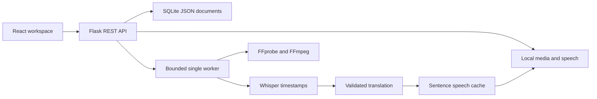

# Architecture

React controls the local listening workspace; Flask serves both the REST API and compiled Vite assets through Waitress. Vite development uses a same-origin proxy. The local server validates Host/Origin and does not enable wildcard CORS.

## Data and processing

Generated project IDs and fixed internal filenames prevent client-supplied paths. FFprobe checks actual streams and bounded duration. Allowed demuxers and local file/pipe protocols restrict media interpretation. Commands use argument arrays without a shell. Audio is extracted into ten-minute mono 16 kHz, 64 kbps MP3 chunks with an explicit 24 MiB upload check. Word timestamps get global chunk offsets; segment timing is used only when actual provider-timed segments exist.

SQLite stores whole JSON project documents using separate connections and serialized read-modify-write operations. Source text and timing are immutable. Translated text maps to original IDs, and speech references map to language/voice/segment. Hashes include exact text and model. Edited translations invalidate all voice references for that sentence; old files are removed on project deletion.

One worker handles up to four queued/active projects. Each stage is persisted, so retry reuses completed work. Cancellation is cooperative between external calls and extraction chunks. Restarted jobs become visible errors. Multiple WSGI processes are unsupported because the job registry is process-local.

## Playback state machine

The two media ports are original video/audio and translated audio. Phases: idle, original, translation, paused, ended. Starting either port pauses the other. Epoch tokens invalidate stale promises and completion callbacks after seeks, mode changes, pause, or disposal.

Original→Translation preserves leading, inter-sentence, and trailing source content; it freezes video during each translated clip. Translation→Original plays source gaps before the next translation, then plays the original sentence. Translation Only holds representative frames and omits source pauses. Original Only plays normally. Pause/resume preserves translated position.

Animation-frame boundary checks are practical browser synchronization, not sample-accurate audio alignment. Background throttling can reduce timing precision.

## API

| Method | Route | Operation |
|---|---|---|
| GET | /api/health | Capabilities, no credentials |
| GET/POST | /api/projects | List / multipart upload field file |
| GET/PATCH/DELETE | /api/projects/:id | Read / metadata / safe deletion |
| POST | /api/projects/:id/process | Start with source, target, voice |
| POST | /api/projects/:id/translations | Additional target/voice |
| POST | /api/projects/:id/tts | Speech for existing translation |
| POST | /api/projects/:id/cancel | Cooperative cancellation |
| GET | /api/projects/:id/status | Persistent job snapshot |
| GET | /api/projects/:id/transcript | Originals and translations |
| PATCH | /api/projects/:id/segments/:sid | favorite or target + translated_text |
| GET | /api/projects/:id/media | Range-capable media |
| GET | /api/projects/:id/audio/:sid?target=en&voice=coral | Referenced speech |
| GET | /api/projects/:id/export?format=srt&language=translated&target=en | UTF-8 downloads |
| POST | /api/demo | Labeled offline fixture project |

Errors use `{"error":{"message":"..."}}`: 400/422 validation, 404 missing resource, 409 active-job conflict, 413 oversized upload. Credentials stay server-side. This MVP has no authentication, public deployment hardening, encryption at rest, or disk quota.
